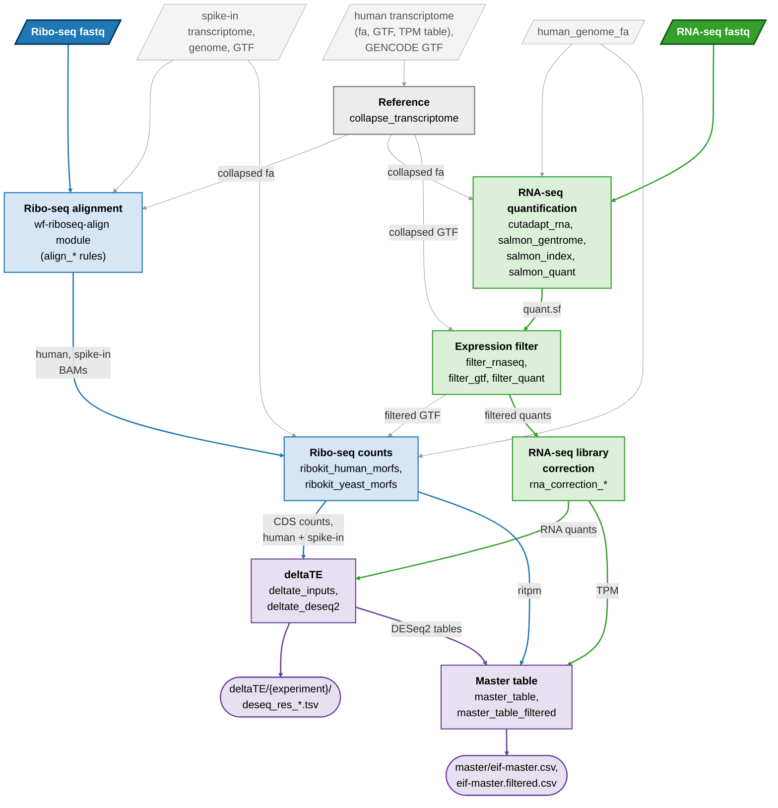

# wf-eIF-deltaTE

Translational-efficiency (deltaTE) analysis of human Ribo-seq and RNA-seq: per experiment, the
change of every transcript between two conditions in Ribo-seq, in RNA-seq and in translational
efficiency. The Ribo-seq libraries carry a spike-in (yeast in the config and output names), from
which their size factors can be taken.

Ribo-seq fastq -> [wf-riboseq-align](https://github.com/katarinagresova/wf-riboseq-align)
(trimming, contaminant filter, bowtie), imported as a Snakemake module ->
[ribokit](https://github.com/katarinagresova/ribokit) (Ribo-seq reads per CDS); RNA-seq fastq ->
adapter trimming -> salmon -> expression filter -> RNA-seq library correction; both -> DESeq2 deltaTE model ->
master table. Both assays are counted on the same transcriptome, collapsed by coding sequence.



The bold inputs are the fastqs in `samples.csv`, the grey ones the references in `config.yaml`; square boxes are
groups of rules (blue: Ribo-seq, green: RNA-seq, purple: both), rounded boxes the main outputs. Every step runs per
experiment except the reference, the alignment and salmon indexes, and the master table (all experiments). Not shown:
the contaminant set wf-riboseq-align ships, FastQC and MultiQC, and the collapsed reference that the library
correction (transcript length and GC) and the master table (annotation) also read.

The experiments, their conditions and their libraries are defined in the sample sheet,
`config/samples.csv`: its `experiment` column splits the libraries into as many experiments as
it names, and config `timepoints` selects which of them run (those at the timepoints listed).
Adding an experiment takes only its rows there.

## Reference transcriptome

`workflow/rules/collapse_transcriptome.smk` collapses the human transcriptome of config
`collapse_transcriptome` (fasta, GTF, and an external short-read TPM table for the tie-break).
First, the genes that GENCODE (`gencode_gtf`) calls readthroughs are dropped (RPS10-NUDT3): their
CDS spans two genes' CDSs. Then transcripts with an identical CDS keep one, across gene ids too, as a
Ribo-seq read cannot tell them apart; a CDS at least 99% covered by another of the same gene merges
into it; and each gene keeps one transcript. Last, a CDS of which fewer than `min_unique_fraction`
(0.2) of the `kmer`-mers (28) occur in no other CDS merges into the CDS it shares most with
(paralogs: EIF3C / EIF3CL, SMN1 / SMN2). A merged group keeps a protein-coding gene, then the higher
TPM. Readthroughs and paralogs share most of their footprints with another gene, so their counts
jumped between replicates. `results/resources/` holds the collapsed fasta and GTF, and
`collapse_report.tsv` (every group, and why it was resolved). Everything downstream uses it.

## Alignment: wf-riboseq-align as a module

`workflow/rules/align.smk` imports wf-riboseq-align once, from GitHub at a pinned commit, with
the `align:` block of `config/config.yaml` as its config and `config/samples.csv` as its sample
sheet; its rules are renamed `align_<rule>`. It aligns the Ribo-seq only (the `rna` rows are
skipped), to the whole collapsed transcriptome plus the spike-in, and splits the alignments into a
human and a spike-in BAM file. Each experiment gets its own `results/align/<experiment>/` (split
BAMs, `qc/summary.tsv`, FastQC, MultiQC). What does not depend on the experiment (the Ribo-seq
reference and the combined bowtie index of the transcriptome, spike-in and contaminants) is built
once, in `results/align/`.

## RNA-seq: salmon and the expression filter

`workflow/rules/rnaseq.smk`, per experiment:
- cutadapt trims the 3' end of both mates: bases below quality `qualcutoff` (20), then the
  adapter (config `rnaseq_trim`: `adapter`, the start of both TruSeq adapters; a match of at
  least 3 nt); a pair with a mate shorter than `minlength` (35) is dropped.
- salmon 1.10.2 quantifies each paired-end library on its trimmed fastq files, by selective alignment
  (`-l A --seqBias --gcBias`), against an index of the collapsed transcriptome with every
  sequence of the genome (config
  `references: human_genome_fa`) as a decoy: a fragment that aligns better to the genome than to
  any transcript is counted for none. `--keepDuplicates`, so that a transcript whose sequence
  duplicates another's stays in `quant.sf`. salmon samples fragments for its bias models from a
  random seed it does not expose, so a rerun can differ slightly (at most a few transcripts change
  sides of the expression filter's threshold); `-p 1` does not make it deterministic either.
- The expression filter (config `autofilter`): a transcript is kept if its TPM is at least
  `min_tpm` in at least `min_samples` of the experiment's RNA-seq libraries, else blacklisted.
  The blacklist applies to what is counted, not to the Ribo-seq alignment: ribokit counts on the
  collapsed GTF minus the blacklist, and the RNA-seq library correction, then DESeq2, read
  `quant.rnaseq_filtered.sf`: salmon's `quant.sf` minus the blacklisted rows, sorted by name, the
  values as salmon wrote them (TPM is not renormalised).
- For tools other than this workflow's, a copy of each human Ribo-seq BAM without the blacklisted
  transcripts: their `@SQ` lines and alignments removed, every other record as it was (FLAG, NH
  and HI not updated, so a read can be left with secondary alignments only).

The index is built once, in `results/rnaseq/salmon_index/`; `results/rnaseq/<experiment>/` holds
`salmon/<sample>/` (salmon's output and `quant.rnaseq_filtered.sf`),
`rnaseq_filter_blacklist_txid.txt`, `human_transcriptome.rnaseq_filtered.gtf`,
`ribo_bam/<ribo sample>.human.rnaseq_filtered.bam` (+ `.bai`), FastQC of the raw and the
trimmed fastq files (`fastqc/`, `fastqc_trimmed/`) and a MultiQC report of cutadapt, salmon and
both FastQCs (`multiqc/`). The trimmed fastq files are deleted once salmon and FastQC have read them.

## RNA-seq library correction

`workflow/rules/rna_correction.smk`, per experiment and condition, on the filtered quants: each
RNA-seq library's
deviation from its replicates is fitted as a smooth function of transcript length and GC. While
the most variable fit has an SD above `max_sd`, that library is divided by its fit and the
others are refitted (config `rna_correction`). `results/rna_correction/<experiment>/` holds
every library's quant (corrected or copied as is), `scan.tsv` (every fit) and `factors.tsv`.

## Ribo-seq quantification: ribokit

`workflow/rules/ribokit.smk`, per Ribo-seq library: ribokit estimates the P-site offsets from
the reads on the human transcripts and counts the reads per CDS, human and spike-in (with the
human offsets). Only reads of config `read_lengths` count, the same window in every library.
Reads compatible with several CDSs are split by an EM that starts deterministically and fails if
it does not converge. `results/ribokit/<experiment>/` holds
`<sample>.{human,yeast}.{quant,offsets,ties,stats,psites,qc}.tsv` (`psites.tsv`: one row per
alignment assigned to a CDS, its P-site position; `qc.tsv`: every read once, per read length,
P-site region and 5' end phase in the CDS, for QC plots). ribokit is installed from GitHub at the
commit pinned in `workflow/envs/ribokit.yaml`.

## deltaTE: DESeq2

`workflow/rules/deltate.smk`, per experiment with both conditions in both assays (the others
stop after the steps above): the deltaTE model (Chothani et al. 2019), DESeq2 on
the Ribo-seq and RNA-seq libraries together with design `~ condition + assay + condition:assay`;
the change in translational efficiency is the interaction. Fold changes are treatment over
reference (config `conditions`). The Ribo-seq size factors come from the spike-in (`yeastnorm`)
or are estimated within the libraries (`autonorm`). The RNA-seq size factors go into the model
together with salmon's effective transcript lengths, as normalization factors; the Ribo-seq ones
alone (the Ribo-seq is counted on the CDS, whose length is the same in every Ribo-seq library).
Each assay is also fitted alone. ribokit counts
the Ribo-seq on CDSs, so the deltaTE and Ribo-seq models are fitted on the transcripts with a
CDS; the RNA-seq model and the RNA-seq size factors on every transcript. DESeq2's
independent filtering is tuned for hits at padj < 0.05 (`results(alpha = 0.05)`; its default is
0.1). `results/deltaTE/<experiment>/` holds (as `.tsv`, MA plots in `plots/`; DESeq2's input in
`counts.tsv`, `length.tsv`, `sampleTable.tsv`, `spike_in_reads.tsv`):

| table | what |
|---|---|
| `deseq_res_deltaTE_{yeastnorm,autonorm}` | change in translational efficiency (log2FC_TE) |
| `deseq_res_diffribo_{yeastnorm,autonorm}` | Ribo-seq alone (log2FC_RPF) |
| `deseq_res_difftotal_autonorm` | RNA-seq alone (log2FC_RNA) |

## Master table

`workflow/rules/master.smk` -> `results/master/eif-master.csv`: all experiments run with a
deltaTE model, per
transcript: log2FC and padj of TE (`deltaTE_yeastnorm`), RPF (`diffribo_yeastnorm`) and RNA
(`difftotal_autonorm`; a transcript without a CDS has RNA only), the TPM of every library
(ribokit's ritpm, salmon's TPM), log2TE per replicate, the transcript annotation from the
GTF, and last log2FC and padj of TE and RPF with the Ribo-seq size factors estimated from the
human reads instead of the spike-in (`*_TE_autonorm`, `*_RPF_autonorm`: `deltaTE_autonorm`,
`diffribo_autonorm`). The experiments are stacked by target
(the targets in `MASTER_TARGET_ORDER` in master.smk first, any other by name) and timepoint.

`results/master/eif-master.filtered.csv`: the same table restricted, per experiment, to the
transcripts with Ribo-seq ritpm >= 5 and RNA-seq TPM >= 1 in every library of the reference
condition (config `master_filter`). The Ribo-seq floor is the paper's row filter; the RNA-seq
floor drops transcripts whose TE is meaningless because the RNA-seq barely sees them (mostly
histone mRNAs). Filtered after DESeq2, so padj is the full table's.

## Sample sheet

`config/samples.csv` has one row per library: `sample_id`, `target`, `timepoint`, `condition`,
`rep`, `read_type` (`ribo` or `rna`), `fastq_1`, `fastq_2` (empty for single-end) and
`experiment`.
- Experiment names are free (e.g. `<target>_<timepoint>`); nothing parses them, nor the sample
  ids. Assay, condition, target and timepoint come from their columns.
- `condition` is one of the two of config `conditions` (checked when the workflow starts). An
  experiment with both in its Ribo-seq and in its RNA-seq libraries gets the deltaTE model and
  goes into the master table; one without (e.g. a harringtonine experiment with `plusAux`
  libraries only) is aligned and quantified only: up to the RNA-seq library correction and
  ribokit.
- An experiment without RNA-seq libraries (Ribo-seq only) gets no RNA-seq outputs; with no
  expression filter, ribokit counts it on the whole collapsed GTF.

## Setup

- The paths in `config/config.yaml` and `config/samples.csv` are `/path/to/` placeholders. Set
  them there, or put the real ones in an untracked `config/local/config.yaml`, which
  `snakemake.sh` and `slurm_job.sh` pass with `--configfile` when it exists. It needs only the
  keys it changes:
  ```yaml
  samples: "config/local/samples.csv"
  collapse_transcriptome:
    raw_fa: "/data/human_transcriptome.fa"
    raw_gtf: "/data/human_transcriptome.gtf"
    tpm_table: "/data/transcript_tpm_short_read.csv"
    gencode_gtf: "/data/gencode.v47.annotation.gtf"
  align:
    spike_in_transcriptome_fa: "/data/yeast_transcriptome.fa"
  references:
    human_genome_fa: "/data/human_genome.fa"
    yeast_genome_fa: "/data/yeast_genome.fa"
    yeast_gtf: "/data/yeast.gtf"
  ```
- The contaminant set is not built by the run: it is the one wf-riboseq-align ships,
  `resources/contaminants_built.fa`, fetched from GitHub at the pinned commit.
  `align: contaminants_fa: <fasta>` replaces it; to rebuild it from public sources, run its
  `build_contaminants` rule (needs internet access), e.g.
  `./snakemake.sh results/align/reference/contaminants_built.fa`.
- `align_snakefile: <checkout>/workflow/Snakefile` imports a local wf-riboseq-align checkout
  instead of the pinned commit.
- Another dataset, with its own sample sheet and results: a config with the keys that differ
  (`samples`, `RESULTS_DIR`, `LOG_DIR`, e.g. `results_<dataset>` / `logs_<dataset>`, and e.g.
  `align: adapter`, `randomer_5p`, `randomer_3p` for another library kit), passed in `RUN_CONFIG`:
  the drivers layer it after `config/local/config.yaml`, e.g.
  `RUN_CONFIG=config/local/R002/config.yaml ./snakemake.sh -n`.

## Running

Needs a conda env `snake` with snakemake 9 (and snakemake-executor-plugin-slurm for SLURM);
every rule runs in its own conda env.

```
./snakemake.sh -n        # dry run
./snakemake.sh           # local run (workflow/profiles/default)
sbatch slurm_job.sh      # one SLURM job per rule (workflow/profiles/slurm)
```

## License

Apache License 2.0 (`LICENSE`, `NOTICE`).
